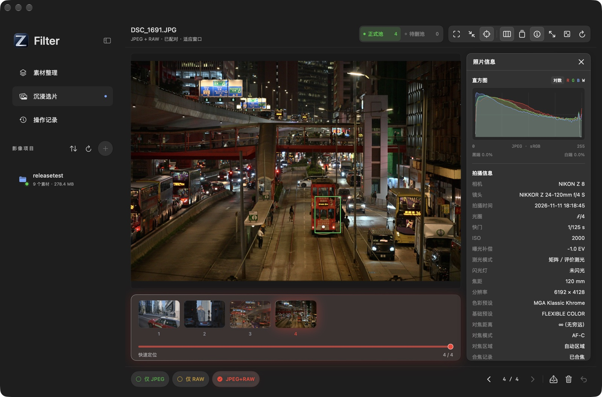
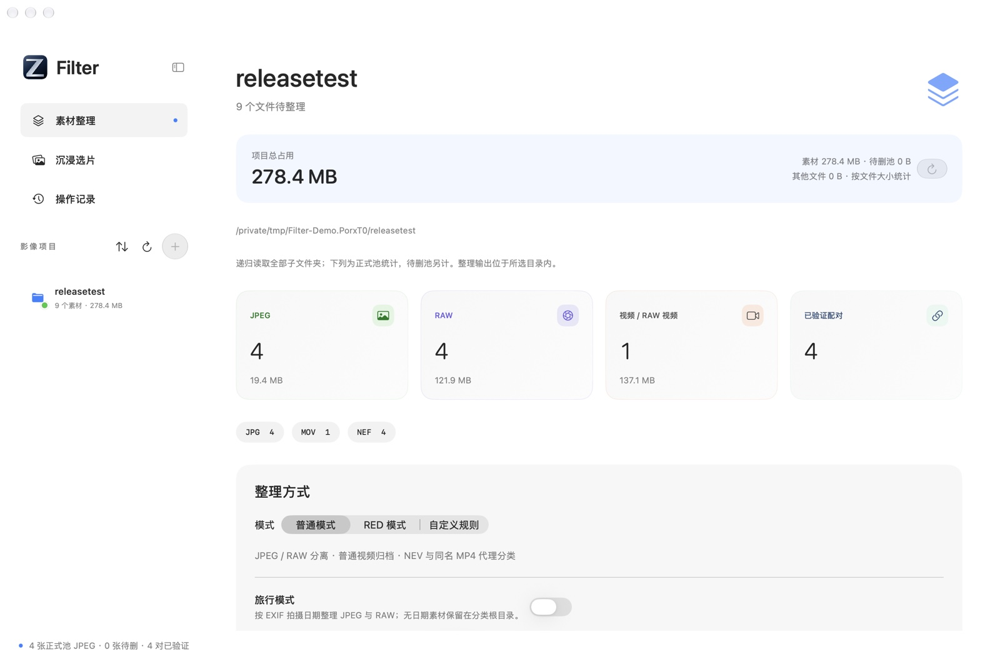

<div align="center">
  
  <h1>ZFilter</h1>
  <p>整理 JPEG、RAW 与视频，在同一个项目里对照配对照片、查看拍摄信息并选片。</p>
  <p><strong><a href="https://github.com/ARCHIC001/ZFilter/releases/download/v1.9.8/ZFilter-1.9.8-macOS-arm64.dmg">下载 macOS 安装包</a></strong> · <strong><a href="https://github.com/ARCHIC001/ZFilter/releases/download/v1.9.8/ZFilter-1.9.9-Windows-x64-preview.zip">下载 Windows 便携版</a></strong></p>
  <p>macOS 26+ · Apple Silicon　|　Windows 11 x64 · 预览版</p>
  <p><a href="https://github.com/ARCHIC001/ZFilter/releases/tag/v1.9.8">版本说明与校验文件</a> · <a href="docs/tutorial.md">图文使用教程</a> · <a href="docs/cli.md">命令行指南</a></p>
</div>



## 从目录整理到沉浸选片

ZFilter 以一个素材文件夹为项目，递归清点文件、验证 JPEG／RAW 配对，并预览每条整理规则的结果。确认整理后，JPEG、RAW 和视频会进入各自的目录。照片分开存放后，仍可在同一个项目里作为一对查看、暂存和恢复。

| 工作 | ZFilter 提供 |
| --- | --- |
| **清点与整理** | 查看项目体积、数量和格式。支持普通、RED、自定义规则、按 EXIF 日期分组的旅行模式，以及只预演的演练模式。每次正式整理留下可撤销的记录。 |
| **配对与查看** | 按整理日志和目录内的唯一候选验证配对。查看全部 JPEG、解码后的 RAW，或仅查看已配对的 JPEG。 |
| **放大与筛选** | 单击 1:1，按 **0** 在相机记录的对焦点放大并跨照片保持。预览条显示前后三张，定位轨跨越整个列表，受支持的 Nikon 连拍可以逐组折叠。 |
| **待删复核** | 正式池中按 **W** 暂存，待删池中按 **W** 恢复。可逐张移入废纸篓，也可确认后移走整个待删池。用 **⌘Z** 或 **Ctrl+Z** 撤回。 |
| **照片信息** | 查看 RGB 与亮度直方图、曝光补偿、测光、闪光、Nikon 色彩预设、对焦距离和 JPEG／RAW 各自的文件大小。 |
| **项目与外观** | 项目支持置顶、排序和外置磁盘在线状态。点击左上角 Logo 或「ZFilter」切换深浅色。 |

## 下载与安装

### macOS 26+ · Apple Silicon

1. 下载 [ZFilter-1.9.8-macOS-arm64.dmg](https://github.com/ARCHIC001/ZFilter/releases/download/v1.9.8/ZFilter-1.9.8-macOS-arm64.dmg)。
2. 打开磁盘映像，将 **ZFilter.app** 拖到 **Applications**。已有旧版时，先退出运行中的 ZFilter。
3. 从「应用程序」打开 ZFilter。整理引擎使用 `/usr/bin/python3`，如果系统提示缺少命令行工具，按提示安装，或在终端运行 `xcode-select --install`。 [Apple 命令行工具安装说明](https://developer.apple.com/documentation/xcode/installing-the-command-line-tools)
4. 当前下载包使用 ad-hoc 签名，首次打开时 macOS 可能要求确认。安装前可对照发布页的 SHA-256，按 Apple 的说明处理首次启动提示。 [校验与首次启动](docs/tutorial.md#安装和首次启动) · [Apple 安全打开指南](https://support.apple.com/zh-cn/102445)

### Windows 11 x64 · 预览版

1. 下载并解压 [ZFilter-1.9.9-Windows-x64-preview.zip](https://github.com/ARCHIC001/ZFilter/releases/download/v1.9.8/ZFilter-1.9.9-Windows-x64-preview.zip)。
2. 打开解压后的 `ZFilter` 文件夹，运行 `ZFilter.exe`，保留同目录的 `_internal`。发布页提供 Windows 包的 SHA-256 校验文件。 [Windows 操作指南](https://github.com/ARCHIC001/ZFilter/blob/windows-preview/docs/windows.md)

## 快速上手

1. 点击侧栏 **＋**，选择包含素材的共同父目录。示例项目 `releasetest` 读取到 **4 张 JPEG、4 张 NEF、1 段 MOV、4 对已验证配对**。
2. 在「素材整理」核对分类预览。打开「演练模式」先试跑，确认后关闭演练并点击「开始整理」。
3. 打开「沉浸选片」。用 **← / →** 切换，按 **I** 查看照片信息，按 **W** 将不要的画面移入待删池。点击顶部橙色待删池复核。



[从安装、预检查到恢复照片的完整图文教程 →](docs/tutorial.md)

## 从源码构建 macOS 版

需要 Apple Silicon、macOS 26 或更新版本，以及带 macOS 26 或更新 SDK 的 Xcode 命令行工具。依赖系统的 Swift、AppKit、ImageIO 和 Python 3 标准库。

```sh
bash GUI/build.sh
bash GUI/package.sh
```

应用写入 `build/ZFilter.app`，DMG 与校验文件写入 `build/dist/`。整理引擎也可通过 `./nikonfilter` 运行。 [命令行指南](docs/cli.md) · [验证与元数据参考](docs/development.md)
