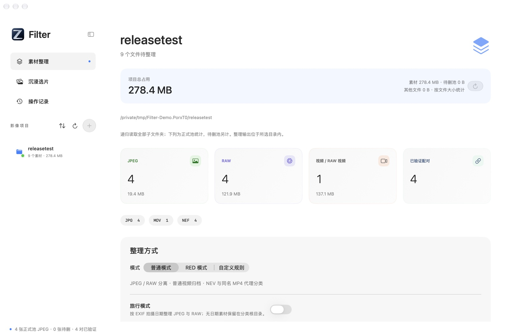
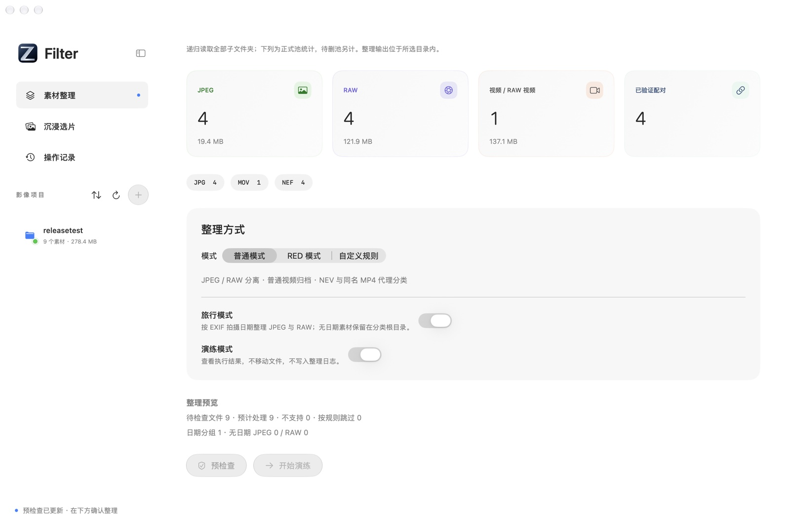
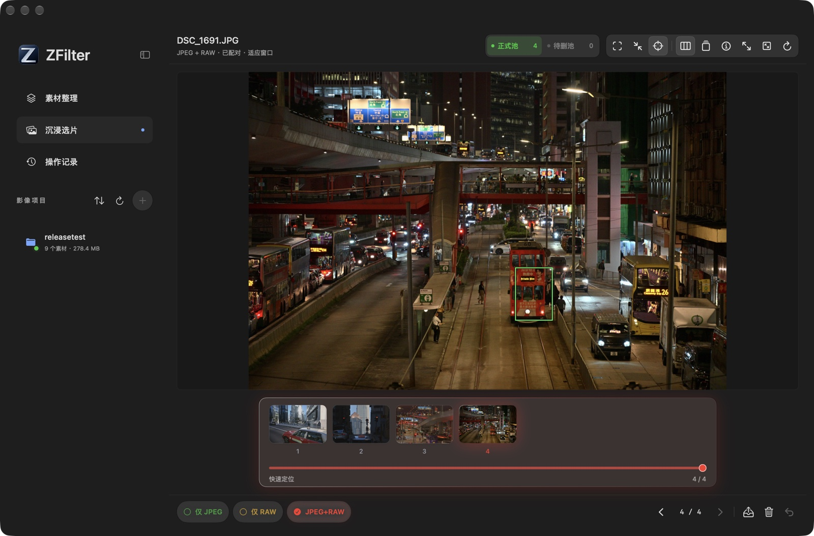
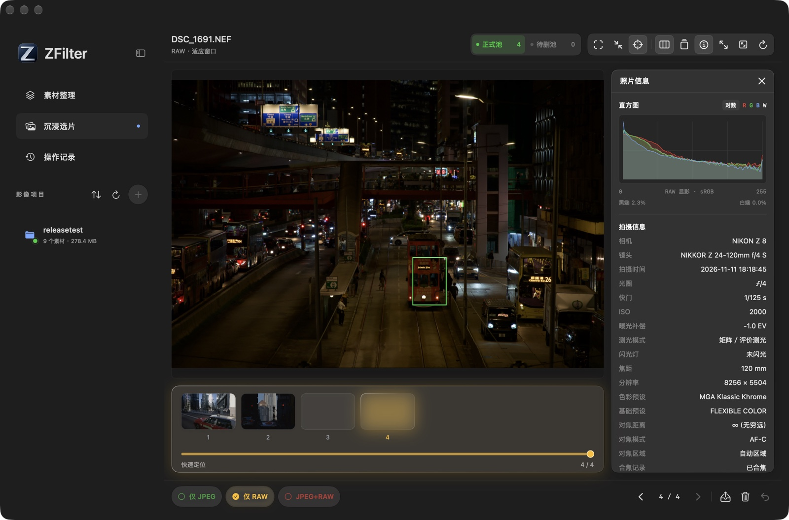
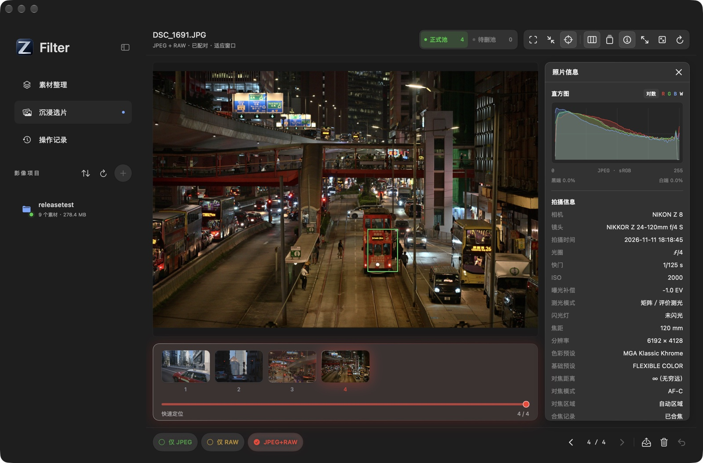
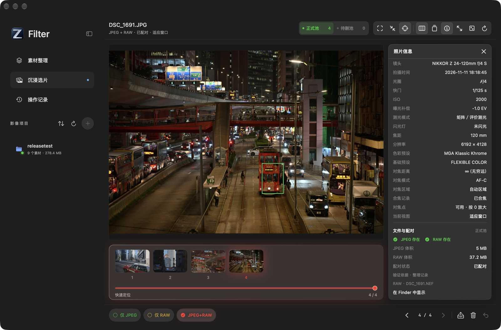
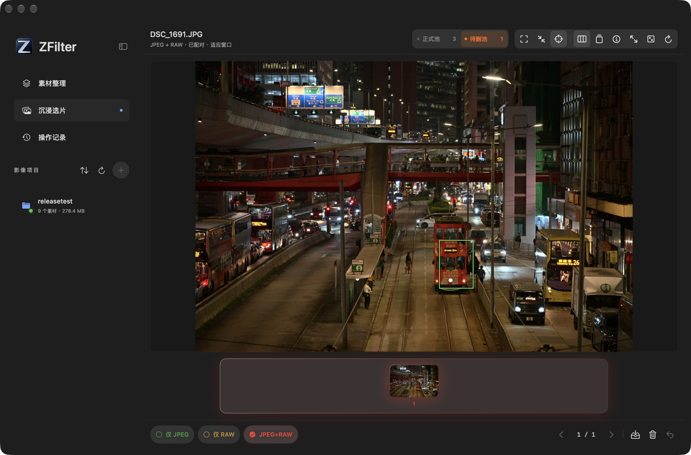
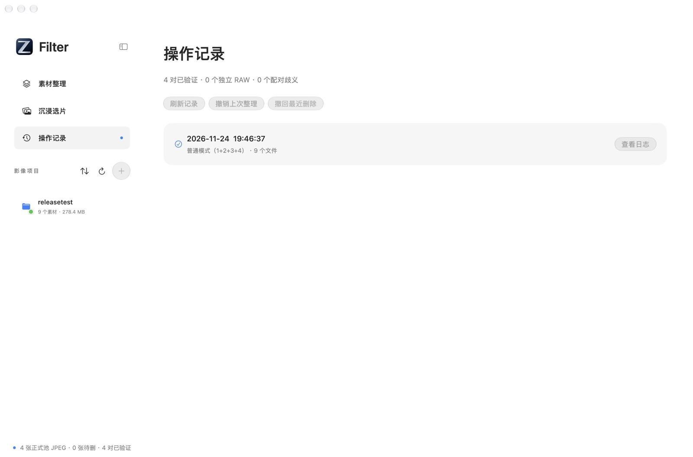

# ZFilter 图文使用教程

[返回项目介绍](../README.md) · [下载安装包](https://github.com/ARCHIC001/ZFilter/releases/latest) · [命令行指南](cli.md)

以下步骤使用名为 `releasetest` 的实际项目副本，内有 Nikon Z8 的 4 对 JPEG／NEF 和 1 段 MOV。你可以用自己的素材副本逐步操作。

## 安装和首次启动

1. 下载 **ZFilter-1.10.1-macOS-arm64.dmg**。它适用于 Apple Silicon Mac，要求 macOS 26 或更新版本。
2. 如需校验，同时下载 **SHA256SUMS.txt**，将两个文件放在同一目录。如果放在「下载」，可在终端运行以下命令，看到 `OK` 后再打开映像。

   ```sh
   cd ~/Downloads
   shasum -a 256 -c SHA256SUMS.txt
   ```

3. 在 Finder 打开 DMG，把 **ZFilter.app** 拖到 **Applications**，然后从「应用程序」打开 ZFilter。当前版本使用 ad-hoc 签名，尚未通过 Apple 公证。若 macOS 阻止启动，核对下载来源和校验结果后，按 Apple 指南在「系统设置 → 隐私与安全性」为 ZFilter 确认打开。 [Apple 安全打开指南](https://support.apple.com/zh-cn/102445)
4. 这版使用系统路径 `/usr/bin/python3`。如果该路径首次运行时提示安装开发者工具，可执行 `xcode-select --install` 完成安装，再重新打开 ZFilter。 [Apple 命令行工具安装说明](https://developer.apple.com/documentation/xcode/installing-the-command-line-tools)
5. 如果系统提示访问文稿或外置卷，请允许访问本次要整理的素材所在位置。

从 1.9.6 升级时，先退出旧版再安装 ZFilter。项目列表、外观设置和撤回记录会自动沿用。确认新版正常后，可以将旧版应用移出「应用程序」。

## 1. 打开目录并核对项目统计

点击侧栏的 **＋**，选中包含全部素材的共同父目录。如果 JPEG 和 RAW 已分别位于两个文件夹，选择上面包含这两个文件夹的目录。扫描只在你选定的目录及其子目录内进行。



示例中，**4 张 JPEG + 4 张 NEF + 1 段 MOV = 9 个待整理文件**，项目共 **278.4 MB**。侧栏的小圆点绿色表示在线，黄色表示离线。排序菜单可按添加顺序、名称、项目日期或大小切换正序和倒序。右键项目可以置顶、设置项目日期、刷新，或仅删除项目记录。

## 2. 预检查并执行整理

| 选项 | 什么时候用 |
| --- | --- |
| **普通模式** | 将 JPEG、RAW 照片、普通视频分开归档，并把 NEV 与其同名 MP4 代理整理进各自子目录。 |
| **RED 模式** | 为需要该目录约定的工作流准备 NEV、代理与转码目录。该规则会将 NEV 文件的后缀改成 `.r3d`，文件编码仍为原样。 |
| **自定义规则** | 只整理指定的文件类别。 |
| **影子模式** | 保留已有文件布局，先在项目旁创建同结构的空待删目录，再选片。 |
| **旅行模式** | 在所选整理规则上按 EXIF 拍摄日期继续划分 JPEG 与 RAW 子目录。没有拍摄日期的照片留在对应分类根目录。 |
| **演练模式** | 实际整理前预演文件处理结果。 |

1. 选择普通模式，打开「旅行模式」与「演练模式」。
2. 向下滚动到「整理预览」，核对预计处理数。选项改变时会更新预览，也可点击「预检查」手动重新统计。
3. 点击「开始演练」并确认。示例仍保留 9 个待整理文件。
4. 关闭演练，点击「开始整理」并确认。示例移入分类目录的 9 个文件仍保留 4 对 JPEG／NEF。



示例的输出结构如下。日志随项目保存，供配对和撤销使用。

```text
releasetest/
├── Jpgreleasetest/
│   └── 20261111Jpgreleasetest/   4 张 JPEG
├── Rawreleasetest/
│   └── 20261111Rawreleasetest/   4 张 NEF
├── NLOGreleasetest/             1 段 MOV
└── .nikonfilter_logs/           整理与恢复记录
```

## 3. 选片、放大和查看 RAW

### 保留目录结构，只做选片

在「素材整理」选择「影子模式」，点击「创建影子待删池并选片」。例如，原素材的 `旅拍/第一天/相机 A` 会对应到 `旅拍 - 待删池/第一天/相机 A`。创建时只复制目录结构，素材仍在原位。正式池按 **W** 后，选中的 JPEG、RAW 或配对文件才会移入影子目录。在待删池按 **W** 可以恢复到原来的子目录。新增了子目录后，点击「同步影子目录并选片」可补齐结构。

同名的普通文件夹会保留原样。若创建时提示目的目录已存在，先检查并移开该同名目录。

### 按目录查看照片

点击沉浸选片顶部的「全部文件夹」，展开目录树并选择要查看的目录。选片范围包含该目录和它的子目录，旅行模式生成的日期目录也从这里打开。正式池和待删池分别保留各自的目录选择，重新选择「全部文件夹」可回到当前池的全部照片。

点击侧栏「沉浸选片」或整理完成后的「开始选片」。左下角三个按钮同时决定浏览范围和 **W / S / Delete** 操作范围。



| 按钮 | 浏览 | 文件操作范围 |
| --- | --- | --- |
| 绿 · **仅 JPEG** | 所有 JPEG | 当前 JPEG |
| 黄 · **仅 RAW** | 所有可解码的 RAW，直接显影大图 | 当前 RAW |
| 红 · **JPEG+RAW** | 已验证配对的 JPEG | 当前 JPEG 和对应 RAW |



- 用 **← / →** 或 **A / D** 逐张浏览。也可点击缩略图，横向拖动预览条，或者拖动下方的「快速定位」轨道后松手跳转。
- 单击照片可在点击处放大到原始像素，拖动查看细节，再点一次缩回。**0 / O** 会开启跨图保持的 100% 对焦点放大；照片没有可用的对焦坐标时以画面中心放大。按 **、** 或点击工具栏缩小按钮，恢复适应窗口。
- **F** 显示或隐藏相机记录的绿色对焦框。**T** 开关预览条。支持的连拍有 **×张数** 或 **帧序号／张数** 角标，点角标只切换这一组，**B** 或顶部叠片按钮切换所有组。
- **Tab** 隐藏或恢复侧栏，左上角 Logo 或「ZFilter」切换深浅色。

## 4. 用直方图、对焦与配对信息判断

按 **I** 或点击右上角信息按钮。直方图支持在对数和线性纵轴之间切换。对数模式便于看低频色阶，线性模式显示相对频率。详情还会显示当前文件里可读的拍摄参数、色彩预设和对焦记录。



在信息面板内向下滚动到 **文件与配对**。示例中 `DSC_1691.JPG` 约 **5 MB**，`DSC_1691.NEF` 约 **37.2 MB**，验证依据为整理记录。将指针停在体积行可查看精确字节数。第三方相机和镜头的 RAW 解码、对焦信息与色彩预设取决于文件记录及 macOS 支持。



## 5. 暂存、恢复与移入废纸篓

1. 确认左下角选中的文件范围。在绿色「正式池」中选中照片并按 **W**。示例选择红色 **JPEG+RAW**，因此两份配对文件一起移到待删池。
2. 点击顶部「待删池」。此时按钮变为橙色，示例中显示 **正式池 3、待删池 1**。可以像正式池一样放大并查看详情。
3. 反悔时按 **W** 恢复当前照片所选范围的文件。确认移除时按 **S** 或 **Delete**，文件进入 macOS 废纸篓。
4. 需要撤回最近一次废纸篓操作时按 **⌘Z**。如果那张照片原先位于待删池，撤回后可以回到待删池再按 **W** 恢复至正式池。清空系统废纸篓后，ZFilter 无法从中恢复文件。



在待删池界面，点击底部「删除整个待删池」，核对确认框列出的目录，再点击「移入废纸篓」。整池操作覆盖当前项目的 JPEG、RAW 待删文件夹及其中的其他内容。按 **⌘Z** 可一次恢复这批文件夹。

## 6. 查看记录与撤销整理

在侧栏打开「操作记录」，可查看整理批次、配对统计与对应日志。点击「撤销上次整理」可回滚最近一次文件整理。「撤回最近删除」对应的是系统废纸篓操作。建议在回滚前先恢复仍在待删池的相关照片，确保整理日志对应的文件位于预期目录。



## 常见问题

- **只看到 JPEG 或 RAW 的一边。** 确认所选项目包含两类文件并刷新。ZFilter 优先依据整理日志，其次依据同目录或项目内唯一同名候选，并在可读时核对 EXIF 日期。出现歧义时，使用单文件范围查看和处理；详情可核对配对依据。
- **外置盘拔出后项目变黄。** 接回磁盘并刷新项目。右键「删除项目」只移除列表记录。
- **没有绿色对焦框或连拍角标。** 打开对应功能，并确认文件自身带有兼容的 Nikon 对焦或连拍记录。对焦距离也是镜头记录的估算值。
- **想批量调用整理规则。** 使用项目保留的 [nikonfilter 命令行入口](cli.md)。
